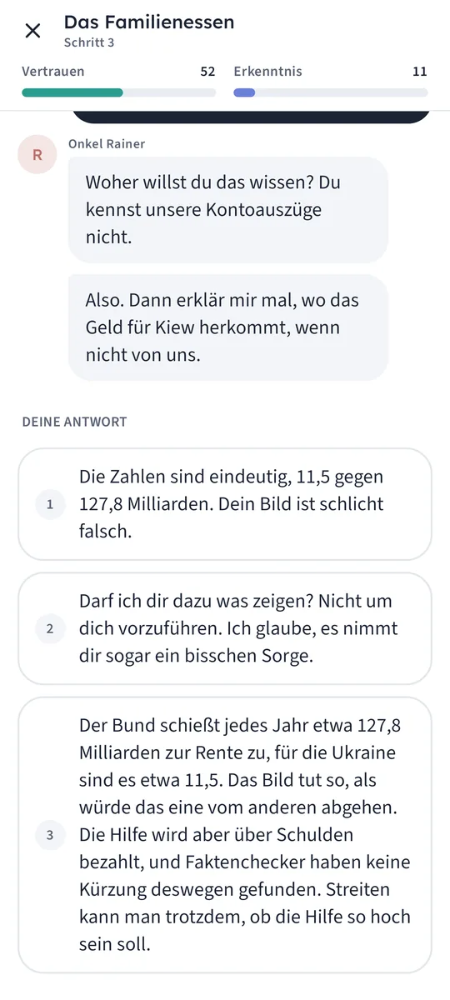
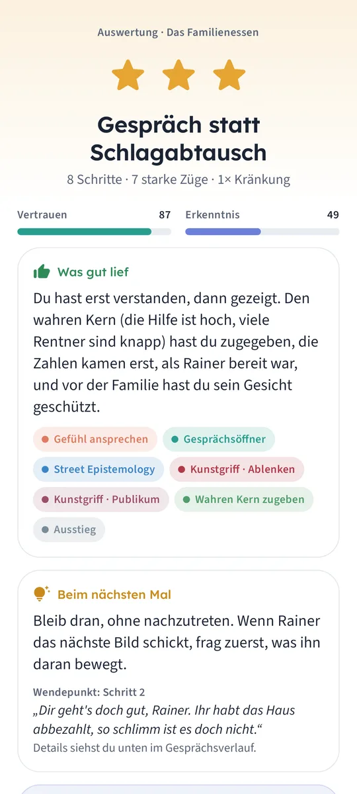
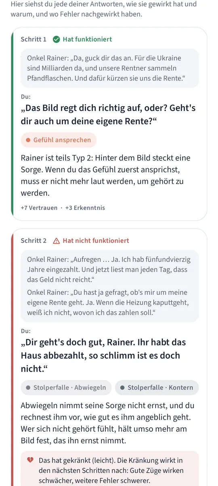

# Gesprächskompass

Android-App zum Üben schwieriger Gespräche: gelassen bleiben, Falschinformationen entschärfen,
die Beziehung schützen. Erster Spielmodus: **Dialog-Duell**. Hintergrund und Entscheidungen
stehen in [`docs/KONTEXT.md`](docs/KONTEXT.md).

- Native App in Kotlin mit Jetpack Compose (Material 3), Paket `de.clemens.gespraechskompass`
- Komplett offline, keine Berechtigungen, kein Tracking
- Inhalte als Daten in [`data/scenarios.json`](data/scenarios.json), Schema in [`docs/SZENARIEN.md`](docs/SZENARIEN.md)

## Ordner

```
gespraechskompass/
├─ data/scenarios.json        Szenarien und Bausteine (einzige Quelle, wird als Asset gepackt)
├─ docs/                      KONTEXT.md, SZENARIEN.md, RECHERCHE.md, RELEASE.md
├─ scripts/
│  ├─ validate-scenarios.mjs  Prüfskript (Node, ohne Abhängigkeiten)
│  └─ pre-commit              Git-Hook, ruft das Prüfskript auf
├─ signing/debug.keystore     fester, öffentlicher Debug-Schlüssel (für Updates über die alte App)
├─ licenses/                  OFL-Lizenzen der Schriften
└─ app/src/main/java/de/clemens/gespraechskompass/
   ├─ data/                   Modelle, Laden der JSON, Fortschritt (DataStore)
   ├─ modes/                  GameMode + ModeRegistry (Spielmodi als Module)
   │  └─ dialogduell/         Engine (reine Logik), ViewModel, Bildschirme
   └─ ui/                     Theme, Komponenten, Startseite, Werkzeugkasten
```

## Befehle

```bash
node scripts/validate-scenarios.mjs        # Szenarien prüfen (muss grün sein)
npm run hook                               # Git-Hook einmalig installieren
./gradlew testDebugUnitTest                # Engine-Tests (spielt jedes Szenario 2000-mal zufällig durch)
./gradlew assembleDebug                    # → app/build/outputs/apk/debug/gespraechskompass-<version>-debug.apk
```

Voraussetzungen: JDK 17+ und das Android SDK (Platform 35). Den Pfad zum SDK trägst du in
`local.properties` ein (`sdk.dir=…`) oder setzt `ANDROID_HOME`.

## Neue Version

In `gradle.properties` die Werte `gk.versionCode` (+1) und `gk.versionName` erhöhen. Dank des festen
Debug-Schlüssels installiert sich jede neue Debug-APK über die alte, und der Fortschritt bleibt erhalten.

## Neuer Spielmodus

1. Ordner `modes/<modus>/` anlegen und darin ein `object : GameMode` mit eigenen Routen in `register(...)` schreiben.
2. Den Platzhalter in `ModeRegistry.modes` durch das Objekt ersetzen.

## Screenshots

`docs/screenshots/` enthält Aufnahmen aus einem automatischen Durchlauf (Robolectric, hell und dunkel).
Neu erzeugen: `./gradlew testDebugUnitTest -Pscreenshots` (legt PNGs ab).

| Gespräch | Auswertung | Verlauf mit Nachwirkung |
| --- | --- | --- |
|  |  |  |
